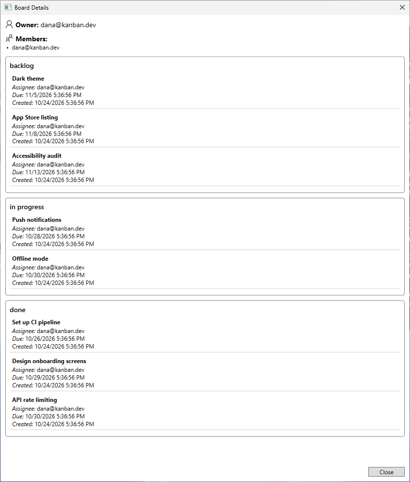
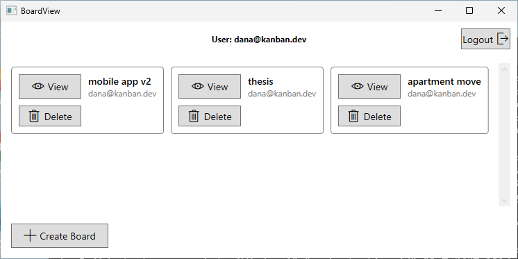
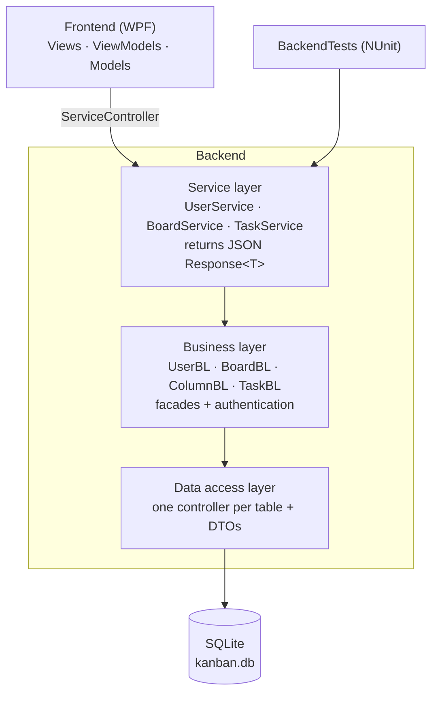

# Kanban Board — WPF + layered C# backend

A desktop Kanban board in C# / .NET 8: a WPF client on top of a backend split into **service, business and data-access layers**, persisted in SQLite and covered by 61 NUnit tests.

[](https://github.com/AsafCo2211/kanban-board-wpf/actions/workflows/ci.yml)


Built for the *Introduction to Software Engineering* course at Ben-Gurion University.

<p align="center">
  
  &nbsp;
  
</p>

The screenshots are taken automatically from the real app: a [GitHub Actions workflow](.github/workflows/screenshots.yml) seeds a demo database through the backend's own services, then drives the WPF client with Windows UI Automation — logging in through the login form and opening the board ([`tools/capture-screenshots.ps1`](tools/capture-screenshots.ps1)).

---

## What it does

**The backend** implements the full domain, exposed through a JSON service layer:

- **Users** — register, log in, log out; email and password validation.
- **Boards** — create, delete, list; members can join and leave; ownership can be transferred.
- **Columns** — backlog → in progress → done, each with an optional limit on the number of tasks.
- **Tasks** — create, edit title / description / due date, assign to a member, advance to the next column, delete. Once a task is assigned, only its assignee may advance or edit it.

**The WPF client** covers part of that: logging in and registering, listing your boards, creating and deleting boards, and viewing a board's columns and tasks. Task operations are available through the backend services (and are exercised by the tests) but have no UI yet.

## Architecture



- **Service layer** — the only API the client sees. Every method returns JSON in the form `{ "ErrorMessage": …, "ReturnValue": … }`, so no exception crosses into the UI.
- **Business layer** — the rules: who may do what, column limits, task state transitions. `AuthenticationFacade` tracks logged-in users.
- **Data access layer** — a controller per table (`Users`, `Boards`, `Columns`, `Tasks`, `Collaborators`) and a DTO per entity. Business objects write through their DTO, so a change in memory and its database row stay in step.
- **Client** — WPF views bound to view-models and models; `ServiceController` is the single bridge to the backend.

## A bug the screenshots exposed

The first automated screenshot showed every task in *in progress* and *done* with **no assignee**, although the demo data assigned every task before moving it.

Moving a task deleted it from its column and inserted a *new* task object in the next one, copying only the title, description and due date. So every move:

- **dropped the assignee** — and with it the rule that only the assignee may move a task: once moved, any member could move it again;
- **reset the creation time** to the moment of the move.

The fix moves the existing task object between columns, so its database row is updated in place ([`BoardBL.UpdateTask`](Backend/BusinessLayer/BoardBL.cs)). Two regression tests cover it — one in memory, one after reloading everything from the database — and both were confirmed to fail before the fix.

---

## Run it

**Requirements:** Windows 10/11 and the [.NET 8 SDK](https://dotnet.microsoft.com/download/dotnet/8.0).

```bash
git clone https://github.com/AsafCo2211/kanban-board-wpf.git
cd kanban-board-wpf
dotnet build Kanban.sln -c Release
dotnet run --project Frontend -c Release
```

Register a user from the login screen, or start with demo data (PowerShell):

```powershell
cd Frontend/bin/Release/net8.0-windows
dotnet ../../../../tools/DemoSeed/bin/Release/net8.0/DemoSeed.dll   # creates kanban.db here
.\IntroSE.Kanban.Frontend.exe                                         # log in: dana@kanban.dev / Demo1234
```

The app reads and writes `kanban.db` in its **working directory**, creating the tables on first run. Delete the file to start fresh.

Passwords must be 6–20 characters with an uppercase letter, a lowercase letter and a digit.

## Tests

```bash
dotnet test BackendTests -c Release
```

61 NUnit tests through the public services: registration and login rules, board creation and membership, column limits, task editing, assignment and permissions, task moves, and persistence across a reload. GitHub Actions runs them on Windows on every push.

`BackendTests` also contains `MainTestRunner`, an earlier console-based scenario runner.

## Project structure

```
Kanban.sln
├── Backend/
│   ├── ServiceLayer/        JSON services, Response<T>, ServiceFactory
│   ├── BusinessLayer/       domain objects, facades, authentication
│   └── DataAccessLayer/     Controllers/ (one per table) and DTOs/
├── Frontend/                WPF client: View/, ViewModel/, Model/
├── BackendTests/            NUnit tests
├── tools/
│   ├── DemoSeed/            builds a demo kanban.db through the services
│   └── capture-screenshots.ps1
├── docs/
│   ├── design.pdf           design document
│   └── screenshots/
└── .github/workflows/       CI (build + tests) and screenshots
```

## Limitations

- **Passwords are stored in plain text** in SQLite. A real system would store a salted hash (bcrypt, Argon2).
- **The UI is partial** — task operations exist only in the backend, as described above.
- **Windows only** for the client (WPF).
- **One shared database file per working directory**; there is no multi-user server.
